# Setara

**An offline learning handheld for village classrooms.** One small app
("star" in Dari) on a game handheld that costs CHF 35 to 50. It gives a
teacher with little training a correct voice and a complete lesson for a
class of up to 50, and it lets children learn by themselves or in pairs.
No internet, no accounts, no personal data. Everything is spoken, so a child
who cannot read yet can use it from the first minute.

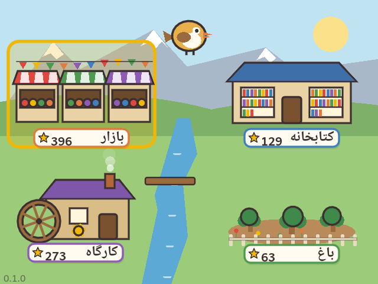

Setara is built for classrooms in Afghanistan, in Dari, by volunteers in
Basel, Switzerland. The code is MIT, the content is CC BY-SA: anyone may
reuse it and translate it.

> **Where this stands.** The software runs on a PC and in a browser. It has
> not yet run on a handheld. All content is a first draft written with an AI
> and has not been reviewed by a Dari-speaking educator, a health
> professional or the people on the ground. It must not reach children
> before that review. See [what a human still has to decide](setara/docs/review-notes.md).

## What it does

| For children | For the teacher |
| --- | --- |
| 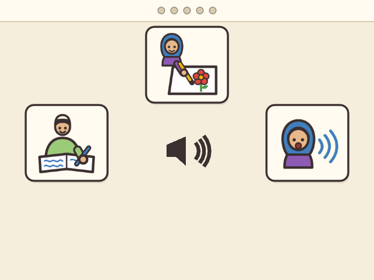 | 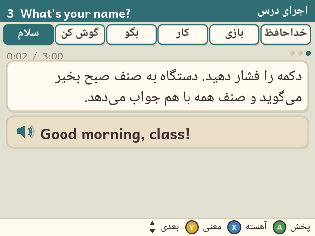 |
| Four subjects in levels: English, Dari reading, math, health and environment. Ten kinds of games, 2 to 4 minutes a round. | A complete English lesson, step by step: the screen says in Dari what to do, one press plays the English through a loudspeaker. |
| 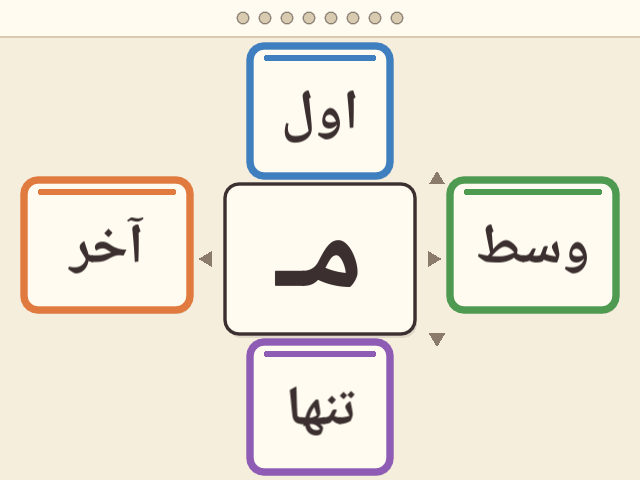 | 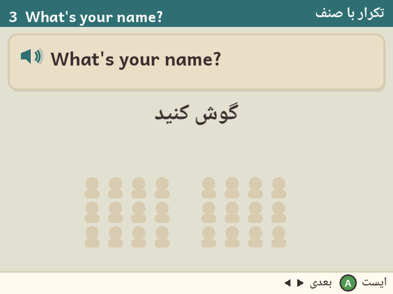 |
| Wrong answers are never punished: they come back later. No lives, no game over, no ranking of children. | Call and response for the whole room, a phrase board, class games, a timer for group work, a private preview the evening before. |

More of it:

| | | |
| --- | --- | --- |
| 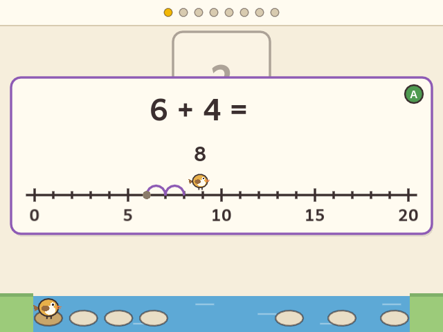 | 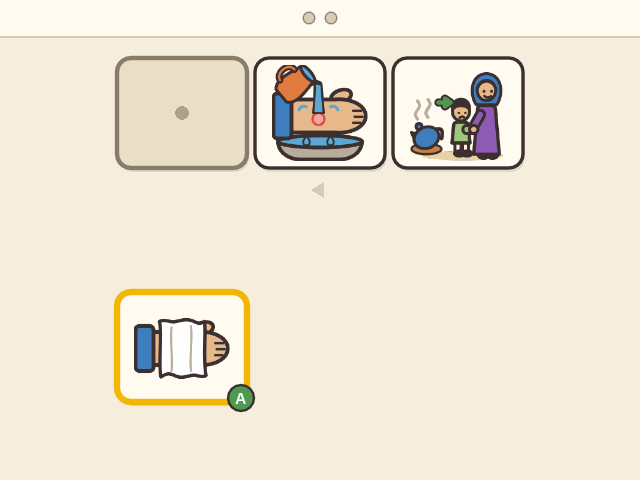 | 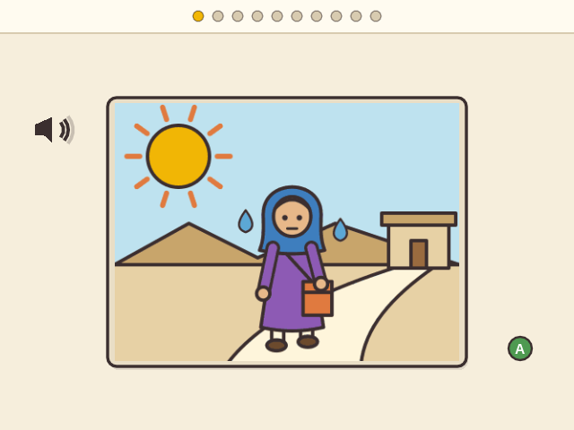 |
| Math you can see | First aid, step by step | Stories with choices |
| 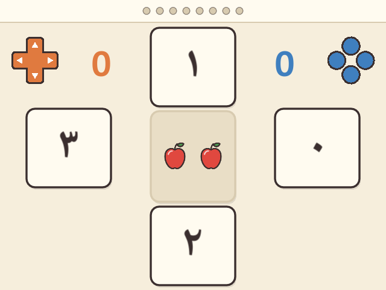 | 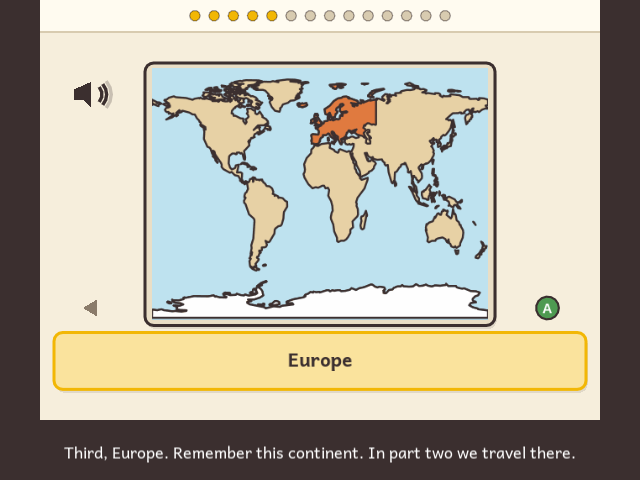 | 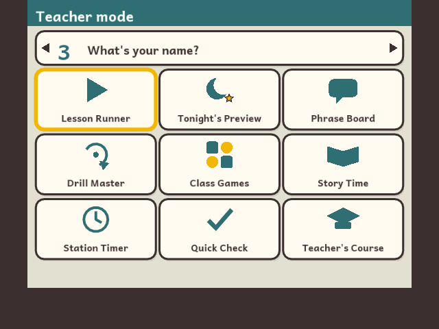 |
| Two children share one device | The world, in English test mode | Nine tools for the teacher |

- **Fully spoken.** Every instruction, word and question has a voice. Eight
  buttons, no typing.
- **Works with nothing.** No connection, ever. New lessons travel on a memory
  card. A damaged card cannot break a device.
- **No personal data.** No names, no photos, no profiles. Only anonymous
  counts, never finer than the week.
- **Content is data.** Lessons are spreadsheets; one command builds speech,
  pictures and right-to-left Dari text into packs.
- **English mode** for testers and partners: every Dari text in English,
  every spoken sentence captioned.
- **Runs in a browser** too, for trying it and showing it.

## What is in it

1,954 rounds in 31 learner packs, a teacher's guide of about 4,900 pages in
22 guide packs, 40 classroom lessons, and about 1,400 pictures:

- **English** 1 to 6, from "Hello" to telling a story, with all 26 letters,
  a story book, and classroom lessons for levels 1 and 2
- **Dari reading** 1 to 6, from hearing sounds to proverbs and poems, with
  all 32 letters and a story book
- **Math** 1 to 6: both digit systems, the number line, word problems from
  village life, tables, fractions, decimals, charts, percent, ratio, a
  household budget; and logic puzzles
- **Health and environment** 1 to 4: hygiene, safe water, food, first aid,
  growth, feelings, drought and flood, energy; a pack on nature and how
  things work, and one on staying well, land and weather in the village
- **Teacher's guide** for every subject: what to teach and how, with
  figures, on the device and for printing
- Two packs the local team may prefer to leave out: children's rights, and
  geography from the globe to Switzerland and Basel

A round is a pool: it asks eight of its questions, different ones each
time. Each level has a guided path: units in order, each one presented,
practised in several forms and reviewed. See
[`setara/docs/curriculum.md`](setara/docs/curriculum.md).

Nearly all of this content was written within a few days by an AI and has
not been reviewed by anyone.

## Try it

```sh
git clone https://github.com/joelgsponer/Setara && cd Setara/setara
cd builder && pip install -e . && python3 -m setara_builder.cli build --tts silent && cd ..
python3 image/make_card.py
dist/card/setara/Setara-English.sh        # needs LÖVE 11.5 (love2d.org)
```

That builds without speech in a few minutes. For voices, a browser version
and a Docker image, see [getting started](setara/docs/getting-started.md)
and [hosting](setara/docs/hosting.md).

## Documentation

Everything is in [`setara/docs/`](setara/docs/README.md):

- [Getting started](setara/docs/getting-started.md)
- [How it fits together](setara/docs/architecture.md)
- [The games](setara/docs/games.md) and [teacher mode](setara/docs/teacher-mode.md)
- [What content exists](setara/docs/content-overview.md) and [what a human still has to decide](setara/docs/review-notes.md)
- [Authoring content](setara/docs/authoring.md)
- [Privacy and safety](setara/docs/privacy-and-safety.md)
- [Putting it on a device](setara/docs/device.md)
- [Questions and answers](setara/docs/faq.md)

## How to help

The most valuable help is not code:

- **Read and hear the Dari.** Teachers and native speakers who check words,
  spelling and how a village child would say it.
- **Check the health and first-aid content**, if you are a health
  professional.
- **Try it on a device** (Anbernic RG35XX H, R36S) and tell us what breaks.
- **Draw.** Six hundred small pictures, some of them weak.
- **Translate** to Pashto or another language.

See [CONTRIBUTING.md](CONTRIBUTING.md).

## Licence

Code: [MIT](LICENSE). Content (lessons, pictures, audio scripts):
[CC BY-SA 4.0](setara/content/LICENSE.md). Fonts: Andika and Noto Naskh
Arabic, SIL Open Font License. Map outlines: Natural Earth, public domain.
